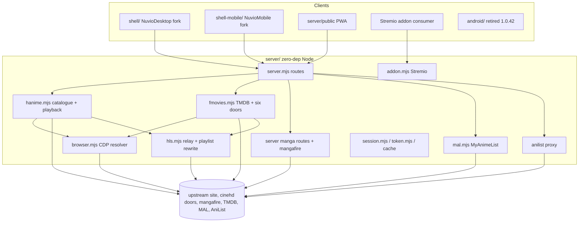

# System architecture

## Overview

Two layers: a local proxy that owns everything upstream, and clients that only
ever speak to it. The clients are forks of finished Nuvio apps carried as
`overrides/` slices (see [[fork-carried-as-overrides]]), so the layer boundary is
the only thing that keeps them maintainable.

## Module graph

## Constraints

- **One proxy, no per-client credentials.** Upstream auth lives in `session.mjs`
  and `token.mjs`; a client never holds it.
- **Playback must be a URL a native player can hold.** Hence the loopback relay:
  upstream playlists are referer-bound and short-lived.
- **No npm dependencies in `server/`.** A dependency-free server is also a
  dependency-free upgrade for a machine that just wants to watch something.
- **The fork boundary is `overrides/`.** Upstream is fetched into
  `.upstream/` by `sync.sh` and the overrides are laid on top, so upstream
  updates stay applicable.
- **The phone app keeps the old shell's package id and signing key.** That is
  what makes an installed 1.0.x app update into the new one, and it is why the
  release key is an operational asset, not a detail.
