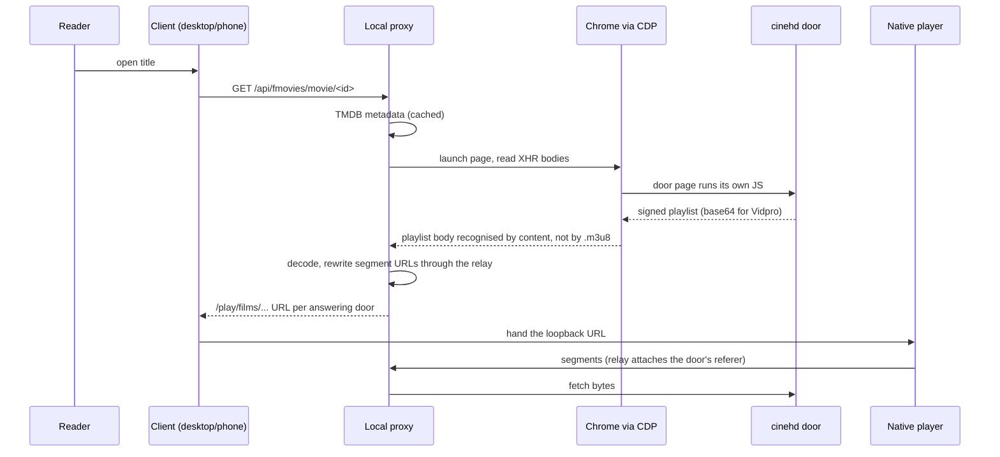

# Key flows

## End-to-end path of a typical request

Opening a film and pressing play, which is the path with every hazard in it:

## Other important flows

- **Catalogue read.** Client asks `/api/...`; the server serves the cached
  `search_hvs` document and filters/sorts/pages locally. No upstream call while
  the 10-minute cache is warm.
- **A phone release.** Bump the fork's xcconfig, build the signed universal APK,
  then *two* publishes: `publish-apk.mjs` (this checkout's own manifest) and
  `publish-github.mjs` (the release phones actually update from). See
  [[phone-release-is-two-publishes]].
- **A desktop release.** `publish-desktop.mjs --pack` builds and publishes a
  prerelease tagged `desktop-v<version>`; the installed window checks on start.
  See [[desktop-releases-tagged-namespaced]].
- **Reading a manga chapter.** Title -> chapters -> pages through the app's
  `/manga/*` routes; pages are fetched through `/manga/page?u=` so the reader
  never needs upstream headers; the position is written as pages turn and is
  what the shelf's progress line is derived from.
