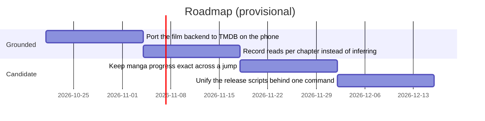

# Roadmap

Provisional. Only the first two items are grounded in an existing decision or a
stated next step; the rest are candidate slices, not commitments.

## Milestones

- **Port `Fmovies.java` to TMDB.** Stated as the next step in `AGENTS.md`: the
  Java twin still scrapes f-movies.org and omits the `source` field, so the
  phone labels films `f-movies`.
- **Record reads per chapter.** The shelf's progress is inferred from a single
  position (see [[manga-progress-from-position]]); a per-chapter record makes it
  exact when a reader jumps around.
- **Candidates.** Unifying the two publish scripts so a phone release cannot be
  half-published again, and finishing the shelf backfill so a long imported
  shelf measures itself in one pass instead of fifteen rows per visit.
