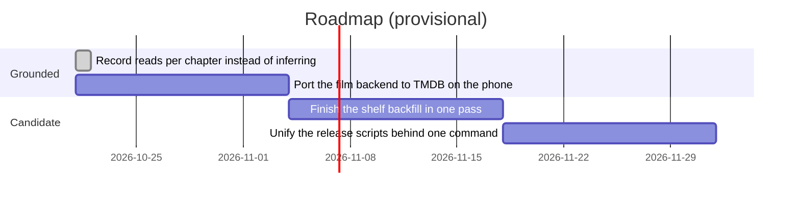

# Roadmap

Provisional. The first item is done in the tree and not yet released; the next is
the one `AGENTS.md` names as the agreed step; the rest are candidates, not
commitments.

## Milestones

- **Done: record reads per chapter.** The title page and the read ink on the
  chapter list come from a stored set of chapter numbers, so a reader who jumps
  is counted by what they opened (see [[manga-read-record]]). The
  trackers keep their own meaning and are told the chapter number.
- **Port `Fmovies.java` to TMDB.** Stated as the next step in `AGENTS.md`: the
  Java twin still scrapes f-movies.org and omits the `source` field, so the
  phone labels films `f-movies`.
- **Candidates.** Measuring a long imported shelf in one pass instead of fifteen
  rows per visit, and unifying the two publish scripts so a phone release cannot
  be half-published again (see [[phone-release-is-two-publishes]]).
